<div align="center">


# ⚡ DISCORD SELFBOT MULTI-ACCOUNT ⚡

**Hệ thống Discord Selfbot Node.js đa tài khoản, tích hợp AI Chat, kiểm tra mạng & tự động hóa chuyên nghiệp**

Developed with ❤️ by **Bé Bii Developer**

[](https://nodejs.org)
[](https://github.com/aiko-chan-ai/discord.js-selfbot-v13)
[]()
[]()

</div>

---

## 🌟 Giới Thiệu Chung

Dự án **Discord Selfbot Multi-Account** là bộ công cụ tự động hóa tài khoản Discord cá nhân chuyên nghiệp được tối ưu hóa toàn diện trên nền tảng **Node.js**.

Hệ thống được thiết kế với cấu trúc module hóa (Modular Architecture), độ ổn định cao, hỗ trợ chạy song song **nhiều tài khoản đồng thời** (Multi-Token), tích hợp trí tuệ nhân tạo (AI Chatbot), quản lý tin nhắn thông minh và nhiều công cụ đo kiểm, tiện ích tự động.

---

## 👑 Về Bé Bii Developer

> **"Code bằng cả đam mê — Tối ưu từng dòng lệnh"**

- **Developer:** **Bé Bii**
- **Lĩnh vực hoạt động:** Phát triển ứng dụng bot Discord, Selfbot, Automation Script & API.
- **Phong cách:** Code tối giản, cấu trúc tường minh, hiệu năng cao và hỗ trợ tính năng đa luồng chuyên sâu.

---

## 🔄 Cấu Trúc Kết Nối File & Luồng Hoạt Động (File Architecture)

Dưới đây là sơ đồ kết nối trực quan giữa file khởi chạy trung tâm ([`index.js`](file:///root/botself/index.js)), các thư mục tài nguyên ([`asset/`](file:///root/botself/asset)), các module lệnh trong [`src/command/`](file:///root/botself/src/command) và các dịch vụ API bên ngoài:

```mermaid
flowchart TD
    subgraph Root ["📁 Thư Mục Gốc (Root)"]
        INDEX["index.js<br/>(Core Dispatcher & Multi-Token Manager)"]
        NHAYDAI["nhaydai.txt<br/>(Dữ liệu tin nhắn nhây)"]
        PKG["package.json<br/>(Dependencies & Scripts)"]
    end

    subgraph AssetDir ["📁 asset/ (Dữ liệu tĩnh & Cấu hình)"]
        TOKEN["asset/login/token.txt<br/>(Danh sách Token đăng nhập)"]
        MUTED["asset/muted_users.json<br/>(Danh sách ID Mute)"]
        CHUI["asset/chui.txt<br/>(Từ khóa câu từ dự phòng)"]
    end

    subgraph SrcCommand ["📁 src/command/ (Các Module Chức Năng)"]
        AI["ai.js<br/>(Tích hợp OpenAI / LLM Model)"]
        NHAY["nhay.js<br/>(Đa tab Nhây & AI Watch Listener)"]
        MUTE["mute.js<br/>(Quản lý mute & xóa tin nhắn vi phạm)"]
        SPEED["speedtest.js<br/>(Đo Ping, Jitter, Down/Up)"]
        FAKE["fakeOnline.js<br/>(Quản lý Session & Presence Gateway)"]
        STREAM["StreamRPC.js<br/>(Định dạng Activity Streaming)"]
        CUSTOM["customstatus.js<br/>(Custom Status Profile)"]
        EMOJI["emoji.js<br/>(Danh mục Emoji)"]
        NHAP["nhap.js<br/>(Typing Indicator Per-Server)"]
        TIKTOK["tiktok.js<br/>(Cào hồ sơ TikTok)"]
        MENTION["mention.js<br/>(Mention Helper)"]
    end

    subgraph External ["🌐 Dịch Vụ Mạng & APIs"]
        DISCORD["Discord Gateway & Shard WS<br/>(discord.js-selfbot-v13)"]
        CF["Cloudflare Speedtest API<br/>(speed.cloudflare.com)"]
        OPENAI["OpenAI / LLM API<br/>(api.xkiro.com)"]
        TIKTOK_API["TikTok Web Endpoint<br/>(tiktok.com/@user)"]
    end

    %% Kết nối từ Root / index.js
    INDEX -->|"1. Đọc đa token"| TOKEN
    INDEX -->|"2. Khởi tạo Client & Shard"| DISCORD
    INDEX -->|"3. Định tuyến lệnh Nhây"| NHAY
    INDEX -->|"4. Kiểm tra & Xử lý Mute"| MUTE
    INDEX -->|"5. Đo tốc độ mạng"| SPEED
    INDEX -->|"6. Cập nhật trạng thái"| FAKE

    %% Kết nối giữa các Module nội bộ
    NHAY -->|"Đọc nội dung nhây"| NHAYDAI
    NHAY -->|"AI Watch: Phân tích tin nhắn"| AI
    AI -->|"Dự phòng từ vựng"| CHUI
    AI -->|"Gọi API sinh câu chửi"| OPENAI

    MUTE -->|"Đọc & lưu trữ dữ liệu"| MUTED

    FAKE -->|"Gắn cấu hình Activity"| STREAM
    FAKE -->|"Gửi Gateway Opcode 3"| DISCORD

    CUSTOM -->|"Lấy dữ liệu Emoji"| EMOJI
    CUSTOM -->|"Broadcast Opcode 3"| DISCORD

    SPEED -->|"Đo kiểm độ trễ & băng thông"| CF
    TIKTOK -->|"Thu thập thông tin user"| TIKTOK_API
    NHAP -->|"Gửi tín hiệu gõ phím"| DISCORD
```



### 🔍 Chi Tiết Tương Tác Giữa Các File:
1. **[`index.js`](file:///root/botself/index.js) (Trung tâm điều phối):**
   - Đọc danh sách token từ [`asset/login/token.txt`](file:///root/botself/asset/login/token.txt), khởi tạo từng phiên Client độc lập với cơ chế giãn cách rate-limit.
   - Lắng nghe sự kiện `messageCreate` và `messageUpdate` để lọc tin nhắn của user bị mute ([`mute.js`](file:///root/botself/src/command/mute.js)) và xử lý lệnh.
2. **Hệ thống Nhây & AI ([`nhay.js`](file:///root/botself/src/command/nhay.js) & [`ai.js`](file:///root/botself/src/command/ai.js)):**
   - [`nhay.js`](file:///root/botself/src/command/nhay.js) đọc file văn bản [`nhaydai.txt`](file:///root/botself/nhaydai.txt) để gửi tin nhắn tuần tự (đa tab theo channel).
   - Khi kích hoạt `nhay rl @user`, module sẽ lắng nghe tin nhắn của mục tiêu và gọi [`ai.js`](file:///root/botself/src/command/ai.js) kết nối trực tiếp đến mô hình AI để phản hồi dằn mặt tức thì.
3. **Quản lý Mute ([`mute.js`](file:///root/botself/src/command/mute.js)):**
   - Quản lý tập hợp ID vi phạm, đồng bộ trực tiếp với tệp JSON [`asset/muted_users.json`](file:///root/botself/asset/muted_users.json) để đảm bảo dữ liệu không bị mất khi khởi động lại bot.
4. **Đo kiểm tốc độ mạng ([`speedtest.js`](file:///root/botself/src/command/speedtest.js)):**
   - Tự động gọi endpoint Cloudflare Speedtest để tính toán Ping, Jitter, Download và Upload mà không cần phụ thuộc thư viện bên ngoài.
5. **Tiện ích mở rộng:**
   - [`customstatus.js`](file:///root/botself/src/command/customstatus.js) phối hợp với [`emoji.js`](file:///root/botself/src/command/emoji.js) để xoay vòng trạng thái.
   - [`nhap.js`](file:///root/botself/src/command/nhap.js) duy trì trạng thái gõ phím theo từng Server.
   - [`tiktok.js`](file:///root/botself/src/command/tiktok.js) bóc tách dữ liệu hồ sơ người dùng TikTok.

---

## 🚀 Các Tính Năng Nổi Bật

### 1. 👥 Đa Tài Khoản (Multi-Token)
- Đọc danh sách token từ file cấu hình độc lập ([`asset/login/token.txt`](file:///root/botself/asset/login/token.txt)).
- Khởi chạy song song không giới hạn số lượng tài khoản.
- Tự động giãn cách thời gian đăng nhập và reconnect thông minh với thuật toán lũy thừa giảm tải (Exponential Backoff).

### 2. 🤖 AI Chat & Phản Hồi Tự Động
- Tích hợp mô hình AI thông minh (Qwen 3.7 Flash, Qwen 3.5 Flash, MiniMax M2.7).
- Chế độ **AI Watch (`nhay rl @user`)**: Tự động nhận diện tin nhắn của mục tiêu và tạo câu phản hồi châm biếm tức thì theo ngữ cảnh.

### 3. 🔇 Quản Lý Mute & Anti-Spam
- **Lệnh Mute:** Tự động theo dõi và xóa tin nhắn (cả tin nhắn mới và tin nhắn chỉnh sửa) của đối tượng bị mute.
- **Anti-Spam:** Tự động phát hiện hành vi spam liên tục 3 tin nhắn và phản hồi cảnh báo.

### 4. ⚡ Công Cụ Kiểm Tra Mạng (Speedtest)
- Đo tốc độ mạng thực tế của máy chủ bot dựa trên hạ tầng **Cloudflare Speed Test**.
- Cung cấp đầy đủ thông số: Ping, Jitter, Tốc độ Download & Tốc độ Upload, thông tin nhà mạng (ISP) và vị trí địa lý.

### 5. 🎭 Trạng Thái & Tiện Ích Tự Động
- Quản lý trạng thái hoạt động linh hoạt, tùy chỉnh presence và các công cụ tra cứu thông tin nhanh.

---

## 📁 Cấu Trúc Thư Mục Dự Án

```plaintext
botself/
├── asset/                          # Thư mục tài nguyên và dữ liệu tĩnh
│   ├── login/
│   │   └── token.txt               # Danh sách token tài khoản (mỗi dòng 1 token)
│   ├── chui.txt                    # Dữ liệu từ khóa câu từ ngắn
│   └── muted_users.json            # Dữ liệu lưu trữ ID các người dùng bị mute
├── src/                            # Mã nguồn chính của bot
│   └── command/                    # Các module tính năng & lệnh
│       ├── ai.js                   # Xử lý sinh phản hồi tự động bằng AI
│       ├── customstatus.js         # Điều khiển trạng thái tuỳ chỉnh & xoay vòng emoji
│       ├── emoji.js                # Danh sách emoji động tuỳ biến
│       ├── fakeOnline.js           # Bộ điều khiển quản lý phiên trạng thái & Presence
│       ├── mention.js              # Module quản lý mention
│       ├── mute.js                 # Quản lý danh sách mute & xóa tin nhắn vi phạm
│       ├── nhap.js                 # Hiệu ứng giả lập đang gõ phím liên tục (Typing indicator)
│       ├── nhay.js                 # Hệ thống nhây tin nhắn đa tab & AI Watch listener
│       ├── speedtest.js            # Đo kiểm tốc độ mạng (Ping, Jitter, Down/Up)
│       ├── StreamRPC.js            # Module xử lý định dạng Presence Streaming
│       └── tiktok.js               # Tra cứu thông tin hồ sơ tài khoản TikTok
├── index.js                        # Điểm khởi chạy chính (Quản lý đa bot & lắng nghe sự kiện)
├── nhaydai.txt                     # Tập hợp nội dung tin nhắn phục vụ tính năng nhây
├── package.json                    # Khai báo cấu hình dự án & dependencies
├── package-lock.json               # Phiên bản chi tiết các gói npm
└── README.md                       # Tài liệu hướng dẫn sử dụng hệ thống
```

---

## 📋 Danh Sách Lệnh (Command Reference)

> **Lưu ý:** Chỉ chính chủ tài khoản (người sở hữu token) mới có quyền sử dụng các lệnh điều khiển.

| Lệnh | Cú pháp | Mô tả chức năng |
| :--- | :--- | :--- |
| **Ping** | `ping` hoặc `!ping` | Kiểm tra độ trễ phản hồi (Response Latency) và WebSocket Ping. |
| **Speedtest** | `speedtest` hoặc `!speedtest` | Đo tốc độ mạng internet (Ping, Jitter, Download, Upload, ISP). |
| **Avatar** | `av @user` hoặc `av <UserID>` | Lấy ảnh đại diện (kích thước lớn 4096px, hỗ trợ GIF động). |
| **Mute** | `mute @user` hoặc `mute <UserID>` | Đưa người dùng vào danh sách im lặng (tự động xóa tin nhắn của họ). |
| **Unmute** | `unmute @user` hoặc `unmute <UserID>` | Gỡ mute cho người dùng. |
| **Mute List** | `mutelist` hoặc `!mutelist` | Hiển thị danh sách tất cả các ID đang bị mute. |
| **Nhây** | `nhay @user` hoặc `!nhay` | Gửi chuỗi tin nhắn tự động từ file `nhaydai.txt` theo chu kỳ 2s. |
| **Nhây RL** | `nhay rl @user` | Bật chế độ AI theo dõi mục tiêu, tự động chửi theo ngữ cảnh khi họ nhắn tin. |
| **Stop** | `stop` hoặc `dung` | Dừng toàn bộ quá trình nhây và theo dõi AI tại kênh hiện tại. |
| **Status Info**| `status` hoặc `device` | Xem bảng thông tin chi tiết về trạng thái kết nối. |
| **Đổi Thiết Bị** | `status <all/mobile/desktop/web>` | Chuyển chế độ hiển thị Online sang Tất cả, Mobile, Máy tính hoặc Web. |
| **Đổi Trạng Thái** | `status <online/idle/dnd/invisible>` | Chuyển trạng thái hoạt động (Trực tuyến, Chờ, Không làm phiền, Ẩn). |
| **Bật/Tắt Stream** | `status stream <on/off>` | Bật hoặc tắt trạng thái phát trực tiếp (StreamRPC). |
| **Anti-Spam Bật** | `a` | Bật tính năng chống spam tin nhắn liên tiếp cho Server hiện tại. |
| **Anti-Spam Tắt** | `b` | Tắt tính năng chống spam tin nhắn liên tiếp cho Server hiện tại. |

---

## 🛠️ Hướng Dẫn Cài Đặt & Sử Dụng

### Yêu cầu hệ thống:
- **Node.js**: Phiên bản `18.x` hoặc `20.x` trở lên.
- **npm**: Trình quản lý gói đi kèm Node.js.

### Bước 1: Cài đặt thư viện
Tại thư mục gốc của dự án, chạy lệnh:
```bash
npm install
```

### Bước 2: Cấu hình Token tài khoản
Mở tệp [`asset/login/token.txt`](file:///root/botself/asset/login/token.txt) và điền token của bạn (mỗi dòng tương ứng với 1 tài khoản Discord):
```text
ODMxNDk4...token_thu_nhat
OTQ3MjEx...token_thu_hai
```

### Bước 3: Khởi động hệ thống
Chạy lệnh sau để khởi động bot:
```bash
npm start
# Hoặc chạy trực tiếp:
node index.js
```

---

## ⚠️ Lưu Ý & Miễn Trừ Trách Nhiệm (Disclaimer)

- Dự án được xây dựng cho mục đích học tập, nghiên cứu giao thức Discord Gateway và giải trí cá nhân.
- Việc sử dụng tài khoản cá nhân cho tự động hóa (Selfbot) có thể vi phạm **Điều khoản dịch vụ của Discord (Discord Terms of Service)**.
- Nhà phát triển **Bé Bii** không chịu trách nhiệm đối với bất kỳ trường hợp tài khoản nào bị cảnh cáo hoặc vô hiệu hóa do sử dụng sai mục đích.

---

<div align="center">

**Project Discord Selfbot** — Thiết kế và hoàn thiện bởi **Bé Bii Developer** ✨

</div>
